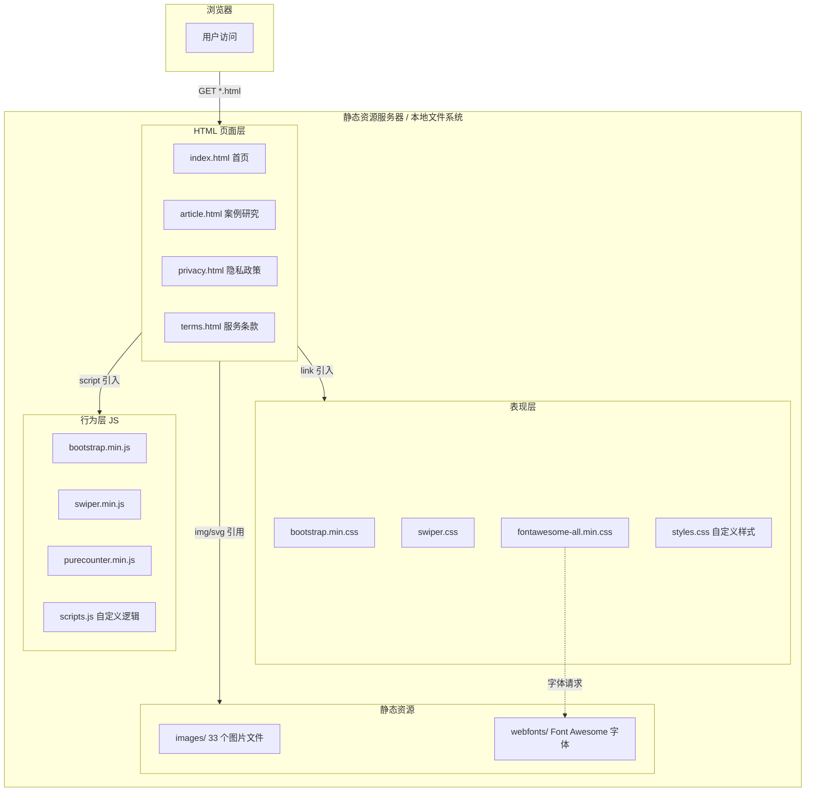
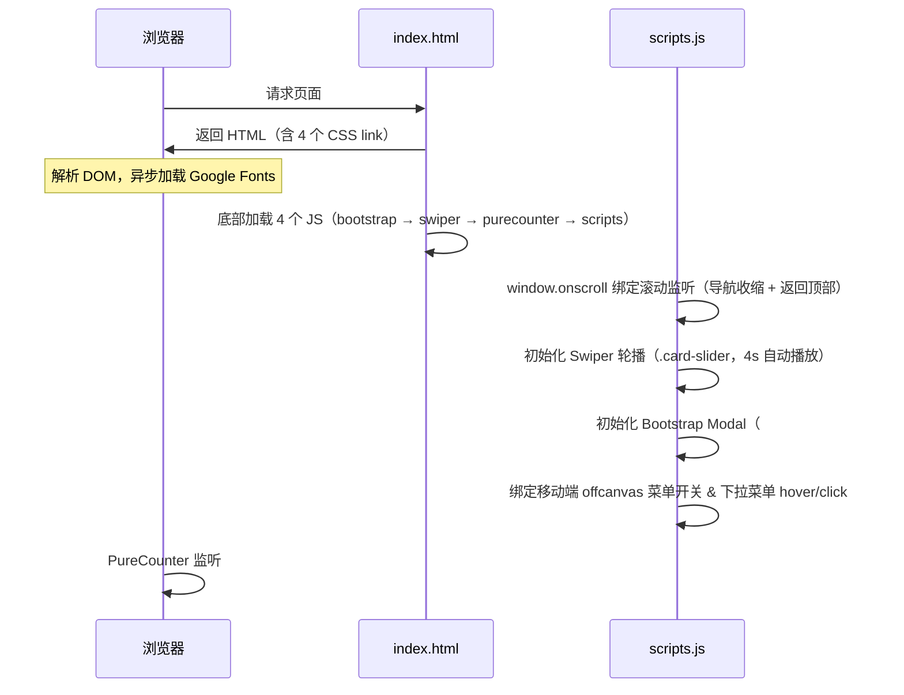
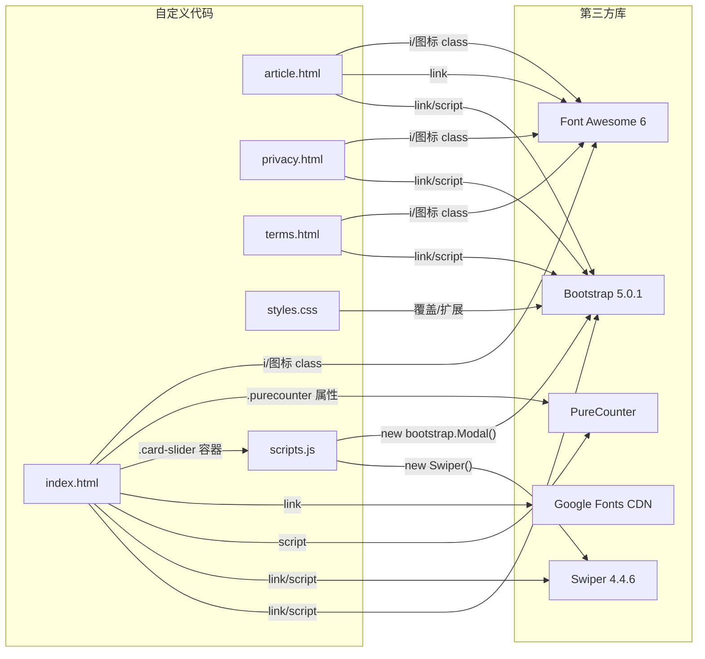

# LJC MOON INC 官网 — Code Wiki

> 本文档由代码库分析自动生成，描述项目的整体架构、模块职责、关键代码、依赖关系与运行方式。
> 分析日期：2026-10-11 · 当前分支：`main` · 远程：`github.com/technext/elma`

---

## 目录

1. [项目概述](#1-项目概述)
2. [整体架构](#2-整体架构)
3. [目录结构](#3-目录结构)
4. [页面模块详解](#4-页面模块详解)
5. [关键 JS 代码说明](#5-关键-js-代码说明)
6. [CSS 架构说明](#6-css-架构说明)
7. [第三方依赖与版本](#7-第三方依赖与版本)
8. [依赖关系图](#8-依赖关系图)
9. [运行方式](#9-运行方式)
10. [部署方式](#10-部署方式)
11. [定制指南](#11-定制指南)
12. [已知问题与注意事项](#12-已知问题与注意事项)

---

## 1. 项目概述

本项目是 **LJC MOON INC**（位于美国加州 Monterey Park 的软件/SaaS/IT 咨询公司）的**企业官网**，基于开源 HTML 模板 **Elma**（作者 Inovatik，MIT 许可证）二次定制而来。

| 属性 | 值 |
|------|-----|
| 项目类型 | 纯静态多页网站（Multi-Page Static Site） |
| 技术栈 | 原生 HTML5 + CSS3 + 原生 JavaScript |
| 构建系统 | **无**（无需编译、无需 npm/node） |
| 后端 | **无**（联系表单无后端处理） |
| 版权/许可 | 模板 MIT 许可，图片来自 Pexels（可免费商用） |
| 代码规模 | 4 个 HTML 页面、1 个自定义 CSS（~1700 行）、1 个自定义 JS（~117 行） |

---

## 2. 整体架构

### 2.1 架构总览



### 2.2 架构特点

- **零构建、零依赖管理**：所有第三方库以 minified 文件形式直接提交到仓库（`css/`、`js/` 目录），无 `package.json`、无打包工具。
- **多页应用（MPA）**：4 个独立 HTML 页面，通过相对路径链接互相跳转；首页内大量使用锚点（`#header`、`#projects` 等）做单页滚动定位。
- **共享布局靠复制**：导航栏、页脚在 4 个页面中为重复的静态 HTML，没有模板引擎或 include 机制，修改公共部分需同步 4 个文件。
- **行为与页面解耦有限**：`js/scripts.js` 在所有页面共享加载，内部用 `if (element !== null)` 防御缺少对应 DOM 的页面（如 article/privacy/terms 没有 modal 和部分元素）。

### 2.3 页面加载流程



---

## 3. 目录结构

```
elma/
├── index.html              # 首页（核心页面，38KB，含全部业务区块）
├── article.html            # 案例研究（Case Study）详情页
├── privacy.html            # 隐私政策页
├── terms.html              # 服务条款页
├── CODE_WIKI.md            # 本文档
├── .gitattributes          # Git 属性配置
│
├── css/                    # 样式目录
│   ├── bootstrap.min.css   # Bootstrap v5.0.1 框架样式
│   ├── fontawesome-all.min.css  # Font Awesome 6 图标库样式
│   ├── swiper.css          # Swiper v4.4.6 轮播样式
│   └── styles.css          # ★ 自定义主样式（~1700 行，按区块注释组织）
│
├── js/                     # 脚本目录
│   ├── bootstrap.min.js    # Bootstrap v5.0.1（Modal/Dropdown/Collapse 组件）
│   ├── swiper.min.js       # Swiper v4.4.6 轮播库
│   ├── purecounter.min.js  # PureCounter 滚动数字计数器
│   └── scripts.js          # ★ 自定义逻辑（导航/轮播/弹窗/返回顶部）
│
├── images/                 # 图片资源（33 个文件）
│   ├── logo.svg            # 公司 Logo
│   ├── favicon.svg / favicon.png  # 站点图标
│   ├── header-background.jpg     # 首页头图背景
│   ├── project-1/2/3.jpg   # 项目展示图
│   ├── details-modal.jpg   # 项目详情弹窗配图
│   ├── process-background.jpg    # 流程区块背景
│   ├── about-background.jpg      # 关于区块背景
│   ├── team-member-1~4.jpg # 团队成员头像
│   ├── testimonial-1~3.jpg # 客户评价头像
│   ├── article-details-large/small.jpg  # 案例研究页配图
│   └── aproject-*.jpg / ateam-member-*.jpg 等  # article 页复用资源（前缀 a）
│
├── webfonts/               # Font Awesome 字体文件（eot/svg/ttf/woff/woff2 三族）
│
└── readme/
    └── readme.txt          # 模板原始说明（许可、文件结构、定制方法、图片来源）
```

---

## 4. 页面模块详解

### 4.1 index.html — 首页（核心页面）

按源码顺序包含以下区块：

| 区块 | HTML 锚点/类名 | 职责 | 涉及 JS/CSS |
|-------|--------------|------|-------------|
| 导航栏 | `#navbar` `.navbar.fixed-top` | Logo + 8 个导航项 + More 下拉（链接 3 个子页面）+ 社交图标 | `scripts.js` 滚动收缩、offcanvas、dropdown |
| Header 头图 | `#header .header` | 大字标语 "SOFTWARE SAAS IT CONSULTING" + Discover/Contact 按钮 | 背景图 + `btn-solid-lg/btn-outline-lg` |
| Introduction | `#intro .basic-1` | 公司简介文案 + `aproject-1.jpg` 插图 | — |
| Projects 项目 | `#projects .basic-2` | Project 1 卡片：Details 按钮（打开弹窗）+ Case Study 链接 | Bootstrap Modal |
| 详情弹窗 | `#staticBackdrop .modal` | 项目详情静态弹窗，CTA 按钮点击后关闭 | `scripts.js` 第 89–97 行 |
| Process 流程 | `.basic-4` | 服务流程步骤展示 | 背景图 |
| Services 服务 | `#services .cards-1` | 4 项服务卡片（SaaS/软件开发/IT 咨询/电商） | `cards-1` 样式 |
| About 数据 | `#about .counter` | 公司简介 + 4 个滚动计数器（50 项目 / 30 客户 / 12 年经验 / 6 行业） | PureCounter |
| Testimonials 评价 | `.cards-2` | 客户评价 Swiper 轮播（`.card-slider`，自动 4s 轮播 + 前后箭头） | Swiper |
| Team 团队 | `.basic-5` | 4 位团队成员卡片（头像 + 姓名 + 职位 + LinkedIn 图标） | — |
| Contact 表单 | `#contact .form-1` | 姓名/邮箱/电话/留言 4 字段表单（**无 action 后端**） | — |
| Footer 页脚 | `.footer` | 三栏：简介文字 / 快捷链接 / 联系方式 + 版权栏 | — |
| 返回顶部 | `#myBtn` | 滚动超 20px 显示，点击回顶 | `scripts.js` |

### 4.2 其余页面

| 页面 | 标题 | 内容概要 |
|------|------|----------|
| [article.html](article.html) | Case Study | 案例研究详情：项目背景、"What we delivered" 交付内容、"Results after six months" 六个月成果、图片与列表 |
| [privacy.html](privacy.html) | Privacy Policy | 6 节隐私条款：信息收集、使用方式、数据共享、数据安全、Cookies、用户权利 |
| [terms.html](terms.html) | Terms & Conditions | 6 节服务条款：服务、知识产权、付款、保证与责任限制、保密、终止 |

> 三个子页面共用同一套导航栏/页脚结构，`scripts.js` 在这些页面同样生效（modal 与部分元素不存在时由 null 检查跳过）。

---

## 5. 关键 JS 代码说明

全部自定义逻辑集中在 [js/scripts.js](js/scripts.js)（117 行），按功能分为 4 个区块：

### 5.1 导航栏（第 3–71 行）

| 函数/逻辑 | 位置 | 职责 |
|-----------|------|------|
| `window.onscroll` | L5–8 | 滚动事件总入口，同时调用 `scrollFunction()` 与 `scrollFunctionBTT()` |
| `scrollFunction()` | L10–23 | 页面下滚超过 30px 且视口宽 > 991px 时，给 `#navbar` 添加 `top-nav-collapse` 类（导航收缩变窄）；回滚到顶部时移除 |
| offcanvas 菜单逻辑 | L26–36 | 为所有非下拉的 `.nav-link` 及 `.navbar-toggler` 绑定点击事件，切换 `.offcanvas-collapse.open` 实现移动端侧滑菜单开合 |
| `toggleDropdown(e)` | L39–53 | 桌面端下拉菜单的 hover 控制：进入立即展开，`mouseleave` 延迟 300ms 收起，并同步 `aria-expanded` 无障碍属性 |
| dropdown click 绑定 | L61–71 | 触屏/点击场景下切换下拉菜单 `show` 状态 |

### 5.2 轮播（第 74–85 行）

```javascript
var cardSlider = new Swiper('.card-slider', {
    autoplay: { delay: 4000, disableOnInteraction: false },
    loop: true,
    navigation: { nextEl: '.swiper-button-next', prevEl: '.swiper-button-prev' }
});
```

实例化客户评价轮播：4 秒自动切换、无限循环、手动操作后不停止自动播放。

### 5.3 详情弹窗（第 88–97 行）

```javascript
const theModal = document.getElementById('staticBackdrop');
if (theModal !== null) {              // 空值防御：子页面无此元素
    const theModalGen = new bootstrap.Modal(theModal);
    const theModalCtaBtn = document.getElementById('modalCtaBtn');
    theModalCtaBtn.addEventListener('click', function () {
        theModalGen.hide();           // 点击 CTA 后关闭弹窗
    })
}
```

### 5.4 返回顶部（第 100–117 行）

| 函数 | 位置 | 职责 |
|------|------|------|
| `scrollFunctionBTT()` | L105–111 | 滚动超过 20px 显示 `#myBtn` 按钮，否则隐藏 |
| `topFunction()` | L114–117 | 点击按钮将 `body` 与 `documentElement` 的 `scrollTop` 置 0（兼容 Safari/Chrome/Firefox/IE/Opera） |

> 注意：`myButton = document.getElementById("myBtn")`（L102）未加 `let/const`，为隐式全局变量，是模板原始写法。

---

## 6. CSS 架构说明

主样式文件 [css/styles.css](css/styles.css)（~1700 行）按模板惯例用大注释分区，结构如下：

```
L36    General Styles        全局：CSS 变量、排版、按钮（btn-solid/btn-outline 系列）
L328   Navigation            固定导航栏 + top-nav-collapse 收缩态 + offcanvas 侧滑菜单
L397   Dropdown Menu         下拉菜单样式（L441 结束）
L475   Header                首屏头图背景与大标题
L510   Introduction          简介区块
L523   Project 1 / L544 Project 2 / L643 Project 3   三个项目展示区块
L573   Details Modal         项目详情弹窗
L669   Process               流程区块（背景纹理图）
L716   Services              服务卡片
L766   About                 关于区块 + 计数器布局
L833   Testimonials          客户评价轮播卡片
L896   Team                  团队成员卡片
L964   Contact               联系表单
L1029  Footer / L1087 Copyright   页脚与版权
L1103  Back To Top Button    返回顶部按钮
L1132  Extra Pages           子页面（article/privacy/terms）通用头部样式
L1190  Media Queries         响应式断点：min-width 768px / 992px / 1200px
```

响应式策略：桌面优先编写，通过三个 `min-width` 断点（768 / 992 / 1200px）渐进增强；移动端导航在 <992px 时切换为 offcanvas 抽屉模式（与 `scripts.js` 中 991px 的判断对应）。

---

## 7. 第三方依赖与版本

所有依赖均为**直接提交的 minified 静态文件**，无包管理器：

| 依赖 | 版本 | 本地文件 | 用途 | 官网 |
|------|------|----------|------|------|
| Bootstrap | **v5.0.1** | `css/bootstrap.min.css` + `js/bootstrap.min.js` | 栅格、导航、Modal、Dropdown、工具类 | getbootstrap.com |
| Swiper | **v4.4.6** | `css/swiper.css` + `js/swiper.min.js` | 客户评价轮播 | swiperjs.com |
| PureCounter | — | `js/purecounter.min.js` | 滚动进入视口时的数字计数动画 | cssscript.com |
| Font Awesome | v6 系（FA CSS） | `css/fontawesome-all.min.css` + `webfonts/`（15 个字体文件） | 全站图标（社交、服务、箭头等） | fontawesome.com |
| Google Fonts | — | CDN 在线引入（无本地文件） | 字体：Open Sans（正文，400/600/700/italic）+ Poppins（标题，600） | fonts.google.com |

> ⚠️ Google Fonts 通过 `<link>` 在线加载（见 [index.html#L21](index.html#L21)），离线环境或国内网络下会回退到系统字体。

---

## 8. 依赖关系图



关系要点：

- **HTML → 第三方**：每个页面顶部 `<link>` 引入 4 个 CSS，底部按顺序 `<script>` 引入 bootstrap → swiper → purecounter → scripts。
- **scripts.js → 库**：依赖全局对象 `Swiper`（Swiper 4 API）和 `bootstrap`（Bootstrap 5 Modal API），因此必须在两者之后加载。
- **styles.css → Bootstrap**：大量基于 Bootstrap 类名的覆盖与扩展（按钮、导航、卡片），与 Bootstrap 版本强耦合。
- **HTML → images/webfonts**：图片、Logo、FA 字体文件按相对路径引用。

---

## 9. 运行方式

本项目为纯静态站点，**无需安装任何依赖、无需构建**。

### 方式一：直接打开（最快）

双击 `index.html` 即可在浏览器中打开（所有资源均为相对路径引用）。

> 限制：个别浏览器对 `file://` 协议下的字体/跨域资源有限制，推荐方式二。

### 方式二：本地静态服务器（推荐）

```powershell
# Python 3（Windows）
python -m http.server 8000
# 然后访问 http://localhost:8000

# 或 Node.js
npx serve .

# 或 VS Code 用户：安装 Live Server 插件后右键 index.html → Open with Live Server
```

### 验证清单

| 功能 | 验证方法 |
|------|----------|
| 导航收缩 | 首页下滚 30px，顶部导航变窄 |
| 移动端菜单 | 窗口 <992px，点击汉堡按钮展开侧滑菜单 |
| 详情弹窗 | 首页 Project 区点击 "Details"，弹窗打开，点击 CTA 关闭 |
| 评价轮播 | Testimonials 区每 4 秒自动切换，箭头可手动翻页 |
| 数字计数 | 滚动到 About 区，4 个数字从 0 滚动到 50/30/12/6 |
| 返回顶部 | 下滚 20px 出现按钮，点击回到顶部 |
| 子页面 | More 下拉菜单 → Case Study / Terms / Privacy 三个页面可跳转 |

---

## 10. 部署方式

任意静态托管均可，无需服务端环境：

- **GitHub Pages**：仓库本身托管在 GitHub（`technext/elma`），开启 Pages 指向 `main` 分支根目录即可。
- **Netlify / Vercel / Cloudflare Pages**：直接拖拽目录或连接 Git 仓库，构建命令留空、发布目录为根 `/`。
- **传统虚拟主机 / Nginx / Apache**：将全部文件上传至 Web 根目录。

---

## 11. 定制指南

摘自 [readme/readme.txt](readme/readme.txt) 并结合代码实际：

1. **修改轮播行为**：编辑 [js/scripts.js#L75-85](js/scripts.js#L75-L85)，按 [Swiper API 文档](https://swiperjs.com/swiper-api) 调整 `delay`、`loop` 等参数。
2. **修改统计数字**：编辑 [index.html#L417-429](index.html#L417-L429) 的 `data-purecounter-end`（目标数值）与 `data-purecounter-duration`（动画秒数）；大数字配短时长可让所有计数器几乎同时结束。
3. **修改配色/布局**：`css/styles.css` 顶部 General Styles 区集中定义了按钮与配色，各区块样式按第 6 节的分区索引定位。
4. **新增页面**：复制 `article.html` 作为骨架，保留 `head`、导航、页脚结构与 4 个 CSS + 4 个 JS 引用；新页面同样会被 `scripts.js` 的空值防御逻辑安全覆盖。
5. **替换图片**：`images/` 目录同尺寸覆盖即可；版权信息见 readme.txt（多数来自 Pexels，可免费商用）。
6. **同步公共区块**：修改导航/页脚时需**同步修改全部 4 个 HTML**（本项目无模板 include 机制）。

---

## 12. 已知问题与注意事项

| # | 问题 | 位置 | 影响 |
|---|------|------|------|
| 1 | **联系表单无后端**：`<form>` 无 `action` 属性，提交不会发送任何数据 | [index.html#L632](index.html#L632) | 上线前需接入 Formspree/自建 API 或移除表单 |
| 2 | 社交图标链接为空占位 `href="#"` | index.html 导航栏与页脚 | 点击无跳转，需替换为真实社媒地址 |
| 3 | Google Fonts 走外网 CDN，无本地回退字体文件 | [index.html#L21](index.html#L21) | 离线/受限网络下字体降级为系统默认 |
| 4 | 依赖较旧：Bootstrap 5.0.1（2021）、Swiper 4.4.6（2018，现主流为 v11） | css/、js/ | 无安全补丁更新；新 API 文档与 v4 写法不兼容 |
| 5 | `myButton` 为隐式全局变量（未声明 `let/const`） | [js/scripts.js#L102](js/scripts.js#L102) | 严格模式下行为不变，但属不良实践；与其他脚本合并时可能冲突 |
| 6 | 仓库含约 12MB 大图（team-member-4.jpg 3.6MB、project-1.jpg 2.3MB 等） | images/ | 首屏加载慢，建议压缩或转 WebP |
| 7 | `scrollFunction` 中条件使用位与 `&` 而非逻辑与 `&&`（`(documentElement.scrollTop > 30) & (intViewportWidth > 991)`） | [js/scripts.js#L14](js/scripts.js#L14) | 布尔场景结果一致，但为模板原始笔误，可读性差 |

---

*文档结束。如需补充 API 级别的说明（本项目无后端 API）或各页面的完整文案清单，可在对应 HTML 文件中直接查看。*
